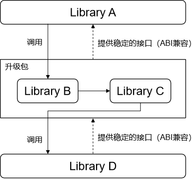
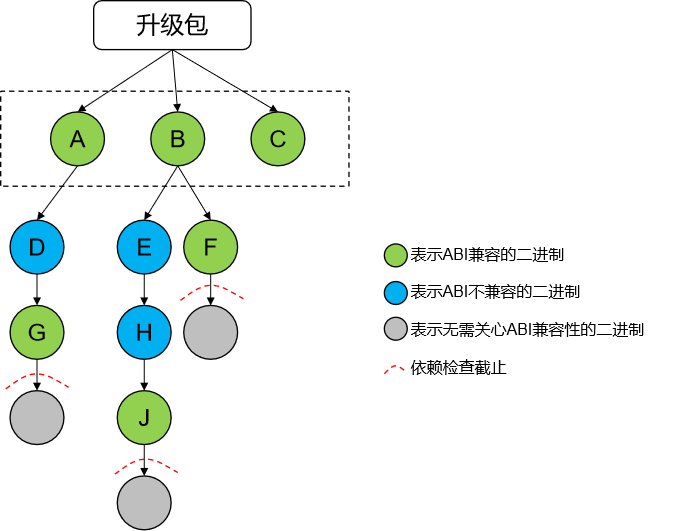

# 模块升级特性方案

## 一、设计目标


模块化升级允许系统开发者在满足依赖接口ABI（Application Binary Interface）稳定的前提下，将系统按模块、服务、或库进行解耦，实现独立打包、独立升级的能力。模块化升级可解决系统的模块解耦，各模块可独立于OTA版本进行发布和演进。

## 二、设计范围

模块化升级主要向OEM厂家的系统开发者提供。模块是指SDK public API层以下的系统服务或库，而非传统应用包。

## 三、实现原理

模块包的制作包含模块定义和模块打包两部分：

1. 通过统一的编译模板（gn模板），定义模块包所包含的基本二进制，以及相关模块基本配置属性（config.json），公私钥定义和签名证书（仅示例，实际产品化时，需要替换为产品化签名密钥对和证书）。通过stable关键词标记，定义依赖接口的ABI稳定性。
2. 模块打包分为单模块包和多个模块包二次打包的HMP包。单模块包是能够升级的最小单位，为了OEM厂家在一次升级过程中能够管理多个模块，系统支持多个模块包统一打包发布。
   模块包涉及到的需要保证ABI兼容的二进制（具体参见[依赖传递和ABI兼容性检查](#五、依赖传递和ABI兼容性检查)），通过ABI校验工具，生成相关二进制的ABI信息文件作为基线，并归档到特定仓。每次模块包编译时，实时生成对应二进制的ABI信息文件，并与基线对比，不一致则编译失败。防止在一个OS大版本内相关的二进制的ABI发生变化，从而导致系统异常。

## 四、约束与限制

1. 当前模块升级能力仅支持 SystemAbility 的升级，独立库形态由于加载依赖机制不同，目前待规划支持。

2. 仅预制到版本中的模块才允许升级，禁止新增模块升级。

   例如：必须是预制到 `/system/module_update` 目录下的模块包才允许升级，不在此目录下的模块包是不会升级的。

3. 当前仅支持模块包升级本地安装和调试，暂未支持云端连接和升级包下载。

## 五、依赖传递和ABI兼容性检查



升级包要能独立于系统单独升级需要有一些约束，即整体升级包对外提供的接口是稳定的，也就是说对外的ABI要能兼容。除了对外稳定，整体升级包调用的接口也需要是稳定的，也就是说升级包依赖的库的ABI也需要是兼容的。

如上图所示，升级包作为一个整体对上提供和对下调用的都需要是稳定的接口。拆开来看，其中：

- 升级包内只有Library B对外提供接口给Library A，所以Library B需要保证ABI兼容性，否则升级后，Library A调用Library B会失败。
- 升级包内只有Library C对外调用了接口且只依赖了Library D，则Library D需要保证ABI兼容性，否则升级后，Library C调用Library D会失败。

如上图所示，Library B和Library D需要声明自身是ABI兼容的。可以通过在编译脚本里加上`stable = true`来声明一个二进制对外的ABI是兼容的。

```plain
ohos_shared_library("LibraryX") {
  ......
  stable = true
  ......
}
```

这样在编译时对相应的二进制做ABI兼容性校验，校验不通过的则编译失败。

ABI兼容性校验通过[libabigail](https://gitee.com/openharmony/third_party_libabigail/blob/master/README_OpenHarmony.md)提供的工具abidw和abidiff来完成。abidw可以将二进制的ABI信息导出为一个文本文件，abidiff可以比较2个ABI信息文件是否相同。所以通过abidw生成前后2个版本的ABI信息文件，然后通过abidiff比较就可以知道二进制的ABI是否发生了变化。为此需要将系统里声明了ABI兼容的二进制的ABI信息文件放入单独的仓中作为基线，这个基线是代码上库时随源码一起合入的。在编译代码时，会生成当前最新的二进制的ABI信息文件并与基线中对应的文件比较，如果失败则表示二进制的ABI发生了变化。当然在开发阶段，这个基线是可以更新的。

具体的以上面图里的Library B作为例子，Library B首次上库时的步骤：

1. 开发完源码后，在Library B的编译脚本里加上：stable = true。
2. 编译代码，发现编译失败，原因是缺少作为基线的ABI信息文件，导致无法比较ABI。
3. 根据编译输出的错误提示，从out目录下拷贝对应的ABI信息文件到基线目录。
4. 再次编译代码，发现编译成功。
5. 将Library B的源码还有对应仓里作为基线的ABI信息文件一起上库。
   当后续再次修改Library B时，如果修改改变了ABI，编译会报错，原因是当前的ABI与基线中的不一致，这时重复上述步骤3到步骤5即可。

需要说明的是，作为基线的ABI信息文件在版本发布后则会冻结，只有在下一个版本中才允许修改。


有时对外提供接口的二进制对下直接依赖的可能不是ABI兼容的二进制，如上图里的Library B，直接依赖了Library C，虽然Library C依赖了ABI兼容的Library D，但Library C本身不是ABI兼容的。所以在编译打包时，Library C也会随Library B一起打包，这样升级包整体对外调用的接口才能保证是ABI兼容的。这样做虽然保证了升级包的可用，但增加了升级包的大小。



依赖检查是一个递归的过程，以升级包直接依赖的二进制作为起点，以它依赖链上的ABI兼容的二进制作为终点，起点和终点会做ABI兼容性校验，校验通过后将除了终点以外的其他节点都打包到最终的升级包中。如上图，最终打包到升级包中的二进制为：A、B、C、D、E、H。所以在规划一个模块是否可以独立升级时，除了要将对外提供接口的二进制改造为ABI兼容的之外，首先需要梳理它们的依赖，总的原则是依赖要少，且依赖的最好都是ABI兼容的二进制，即上述的起点到终点的距离要短。

## 六、修改点

模块包升级运行过程主要涉及到以下几个方面：

- 模块包ABI兼容文件生成与校验
- 模块包签名打包和编译模板
- 模块包校验和挂载
- 模块包加载运行

下面将以仓为单位，从打包编译到挂载运行对模块升级关键功能进行简单说明。

### 1. third_party_elfutils 和 third_party_libabigail 仓

新增 third_party_elfutils 和 third_party_libabigail 两个仓

- third_party_elfutils: elutils项目为ELF文件和DWARF数据提供了库和工具。

- third_party_libabigail: 提供abidw和abidiff工具以分析生成并校验ABI兼容性文件

### 2. build 仓

build 仓更新的主要是以下几个方面的更新：

- 新增主要的编译打包模板 `ohos_module_package` 和 `ohos_hmp`
- 新增生成和校验ABI兼容文件的相关脚本
- 查找校验模块升级包相关库和配置文件并归档到固定目录下

### 3. update_packaging_tools 仓

此仓新增模块升级包打包加密脚本，对模块包目录进行签名打包加密生成模块升级包。

### 4. startup_init_lite 仓

此仓更新如下部分函数代码，以加载运行模块升级相关库以查找校验加载模块升级包。

```c++
static void AddUpdateList(ServiceArgs *args, char *updateList)
{
    char** argvOrig = args->argv;
    const int paramCount = 2; // -u updatelist
    args->argv = (char **)malloc((args->count + paramCount) * sizeof(char *));
    INIT_ERROR_CHECK(args->argv != NULL, return, "Failed to malloc for argv");
    int i = 0;
    for (; i < args->count + 1; ++i) {
        if (i == args->count - 1) {
            args->argv[i] = "-u";
            args->argv[++i] = updateList;
            break;
        } else {
            args->argv[i] = argvOrig[i];
        }
    }
    args->argv[++i] = NULL;
    args->count += paramCount;
    free(argvOrig);
}

void CheckModuleUpdate(ServiceArgs *args)
{
    INIT_LOGI("CheckModuleUpdate start");
    void *handle = dlopen("libmodule_update.z.so", RTLD_NOW);
    INIT_ERROR_CHECK(handle != NULL, return, "dlopen module update lib failed with error:%s", dlerror());
    INIT_LOGI("dlopen success");
    typedef char* (*ExtFunc)(int, char **);
    ExtFunc func = (ExtFunc)dlsym(handle, "CheckModuleUpdate");
    if (func == NULL) {
        INIT_LOGE("dlsym get func failed with error:%s", dlerror());
    } else {
        char *updateList = func(args->count, args->argv);
        INIT_LOGI("update list: %s", updateList);
        if (updateList != NULL) {
            AddUpdateList(args, updateList);
        } else {
            INIT_LOGW("no update list");
        }
    }
    INIT_LOGI("CheckModuleUpdate end");
}
```

### 5. update_sys_installer 仓

此仓是模块升级功能的主要仓，新增的功能主要涉及以下几方面：

- 查找模块升级包相关目录并获取和校验模块升级包
- 将校验通过的模块升级包挂载到 /module_update 目录下对应子目录下
- 模块包安装卸载和本地调测等工具

下面是部分关键代码：

```c++
// 查找校验模块包并挂载激活模块包入口
string ModuleUpdate::CheckModuleUpdate(const string &path)
{
    LOG(INFO) << "CheckModuleUpdate path=" << path;
    Timer timer;
    string ret = "";
    if (!ParseSaProfiles(path)) {
        LOG(ERROR) << "Failed to parse sa profile";
        return ret;
    }
    ModuleFileRepository::GetInstance().InitRepository(saIdSet_);
    ON_SCOPE_EXIT(clear) {
        ModuleFileRepository::GetInstance().Clear();
    };
    PrepareModuleFileList();
    if (moduleFileList_.empty()) {
        LOG(INFO) << "No module needs to activate";
        return ret;
    }
    if (!Loop::PreAllocateLoopDevices(moduleFileList_.size())) {
        LOG(ERROR) << "Failed to pre allocate loop devices";
        return ret;
    }
    if (!ActivateModules()) {
        LOG(ERROR) << "Failed to activate modules";
        return ret;
    }
    ret = GetSuccessSaIdString(status_);
    LOG(INFO) << "CheckModuleUpdate done, duration=" << timer << ", ret=" << ret;
    return ret;
}
```

```c++
// 实际挂载模块包到 /module_update 目录的指定子目录下
bool ModuleUpdate::MountModulePackage(const ModuleFile &moduleFile, const bool mountOnVerity) const
{
    string mountPoint = string(MODULE_ROOT_DIR) + "/" + std::to_string(moduleFile.GetSaId());
    LOG(INFO) << "Creating mount point: " << mountPoint;
    Timer timer;
    int ret = 0;
    if (!CreateDirIfNeeded(mountPoint, MOUNT_POINT_MODE)) {
        LOG(ERROR) << "Could not create mount point " << mountPoint << " errno: " << errno;
        return false;
    }
    ON_SCOPE_EXIT(rmDir) {
        ret = rmdir(mountPoint.c_str());
        if (ret != 0) {
            LOG(WARNING) << "Could not rmdir " << mountPoint << " errno: " << errno;
        }
    };
    if (!IsEmptyFolder(mountPoint)) {
        LOG(ERROR) << mountPoint << " is not empty";
        return false;
    }
    const string &fullPath = moduleFile.GetPath();
    if (!moduleFile.GetImageStat().has_value()) {
        LOG(ERROR) << "Could not mount empty module package " << moduleFile.GetPath();
        return false;
    }
    const ImageStat &imageStat = moduleFile.GetImageStat().value();
    Loop::LoopbackDeviceUniqueFd loopbackDevice;
    if (!CreateLoopDevice(fullPath, imageStat, loopbackDevice)) {
        LOG(ERROR) << "Could not create loop device for " << fullPath;
        return false;
    }
    LOG(INFO) << "Loopback device created: " << loopbackDevice.name;

    string blockDevice = loopbackDevice.name;
    if (mountOnVerity) {
        if (!CreateDmDevice(moduleFile, blockDevice)) {
            LOG(ERROR) << "Could not create dm-verity device on " << blockDevice;
            return false;
        }
    }
    uint32_t mountFlags = MS_NOATIME | MS_NODEV | MS_DIRSYNC | MS_RDONLY;
    LOG(INFO) << "fsType=" << imageStat.fsType;
    ret = mount(blockDevice.c_str(), mountPoint.c_str(), imageStat.fsType, mountFlags, nullptr);
    if (ret != 0) {
        LOG(ERROR) << "Mounting failed for module package " << fullPath << " errno:" << errno;
        return false;
    }
    LOG(INFO) << "Successfully mounted module package " << fullPath << " on " << mountPoint << " duration=" << timer;
    loopbackDevice.CloseGood();
    CANCEL_SCOPE_EXIT_GUARD(rmDir);
    return true;
}
```

### 6. systemabilitymgr_safwk 和 systemabilitymgr_samgr 仓

这两个仓主要是开启模块升级功能开关和实际加载运行模块包功能。

```c++
// 加载模块包库
void ParseUtil::OpenSo(SaProfile& saProfile)
{
    if (saProfile.handle == nullptr) {
        string fileName;
        string libDir;
        ParseLibPath(Str16ToStr8(saProfile.libPath), fileName, libDir);
        if (libDir != "lib64" && libDir != "lib") {
            HILOGE("invalid libDir %{public}s", libDir.c_str());
            return;
        }
        bool loadFromModuleUpdate = false;
        Dl_namespace dlNs;
        string updateLibPath = GetRealPath("/module_update/" + ToString(saProfile.saId) + "/" + libDir + "/"
            + fileName);
        if (IsUpdateSA(ToString(saProfile.saId)) && CheckPathExist(updateLibPath)) {
            HILOGI("create namespace to load so");
            Dl_namespace currentNs;
            string nsName = "module_update_" + ToString(saProfile.saId);
            dlns_init(&dlNs, nsName.c_str());
            dlns_get(nullptr, &currentNs);

            string libLdPath = GetRealPath("/module_update/" + ToString(saProfile.saId) + "/" + libDir);
            if (!libLdPath.empty()) {
                dlns_create(&dlNs, libLdPath.c_str());
                dlns_inherit(&dlNs, &currentNs, nullptr);
                loadFromModuleUpdate = true;
            }
        }

        string dlopenTag = ToString(saProfile.saId) + "_DLOPEN";
        HITRACE_METER_NAME(HITRACE_TAG_SAMGR, dlopenTag);
        int64_t begin = GetTickCount();
        DlHandle handle = nullptr;
        if (loadFromModuleUpdate) {
            handle = dlopen_ns(&dlNs, updateLibPath.c_str(), RTLD_NOW);
        }
        if (handle == nullptr) {
            handle = dlopen(Str16ToStr8(saProfile.libPath).c_str(), RTLD_NOW);
        }
        HILOGI("[PerformanceTest] SA:%{public}d OpenSo spend %{public}" PRId64 " ms",
            saProfile.saId, GetTickCount() - begin);
        if (handle == nullptr) {
            ReportAddSystemAbilityFailed(saProfile.saId, fileName);
            HILOGE("dlopen %{public}s failed with errno:%{public}s!", fileName.c_str(), dlerror());
            return;
        }
        saProfile.handle = handle;
    } else {
        HILOGI("SA:%{public}d handle is not null", saProfile.saId);
    }
}
```

