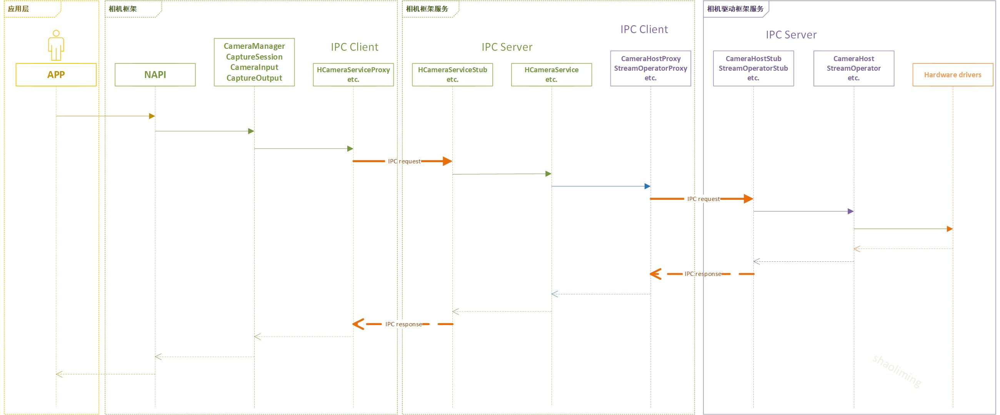
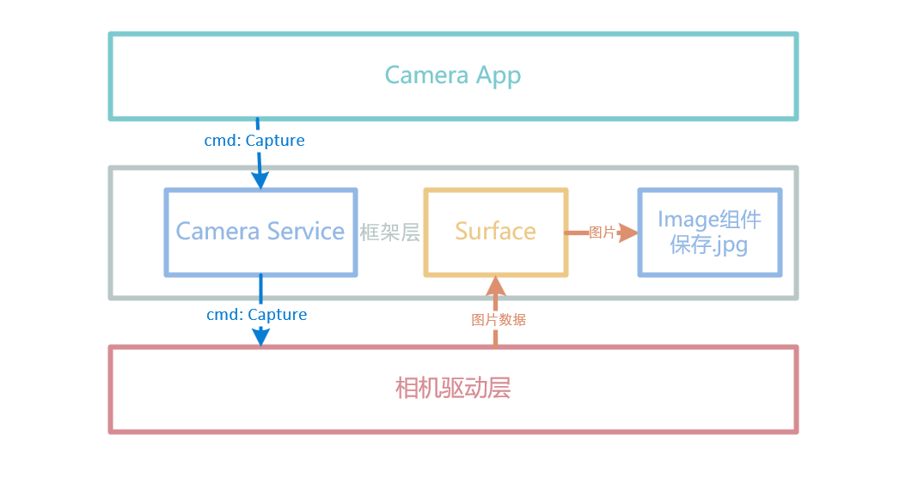
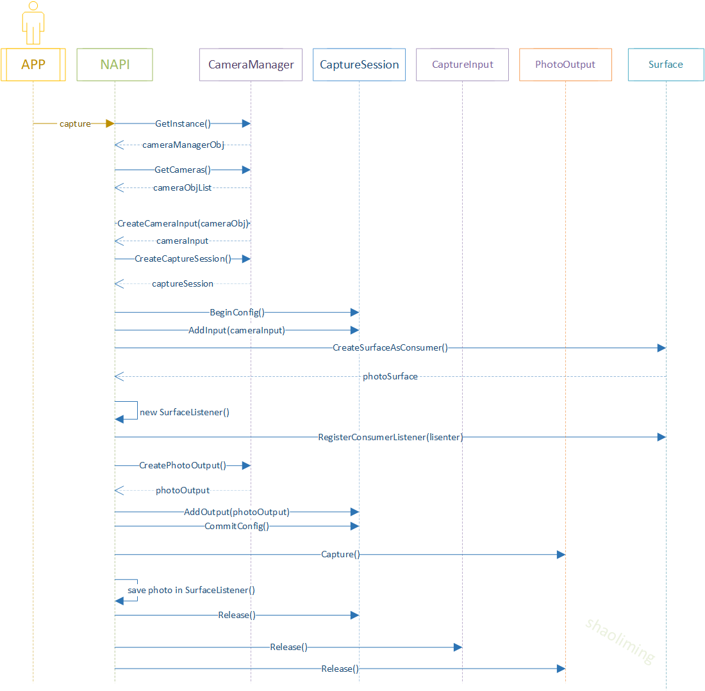
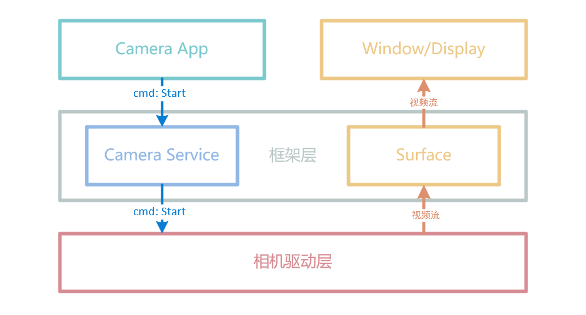
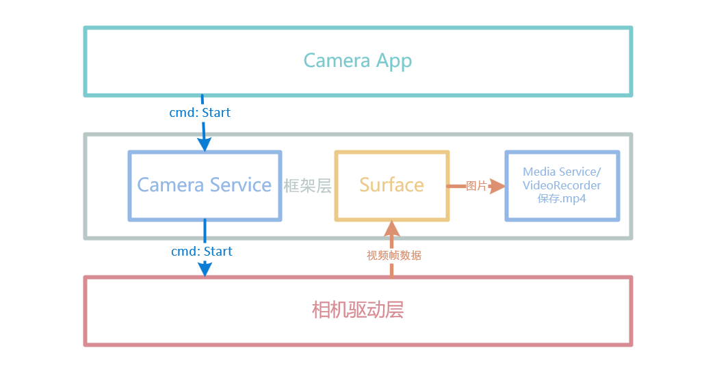

> 本文以 OpenHarmony 4.0 Release - multimedia_camera_framework 源码为基础进行分析。

# 概述

相机功能是现在智能设备一个非常重要的功能。OpenHarmony 相机组件支持相机业务的开发，开发者可以通过已开放的接口实现相机硬件的访问、操作和新功能开发，最常见的操作如：预览、拍照和录像等。

# 基本概念

## 拍照

此功能用于拍摄采集照片。

## 预览

此功能用于在开启相机后，在缓冲区内重复采集摄像帧，支持在拍照或录像前进行摄像帧预览显示。

## 录像

此功能用于在开始录像后和结束录像前的时间段内，在缓冲区内重复采集摄像帧，支持视频录制。

# 相机框架 4.0 版本更新内容

新增美颜功能接口，但是底层没有实现。

```js
enum BeautyType {
  AUTO_TYPE = 0,
  SKIN_SMOOTH = 1,  // 磨皮
  FACE_SLENDER = 2, // 瘦脸
  SKIN_TONE = 3,    // 美白
}

interface PortraitSession {
  getSupportedPortraitEffects(): Array<PortraitEffect>;
  getPortraitEffect(): PortraitEffect;
  setPortraitEffect(effect: PortraitEffect): void;
  getBeauty(type: BeautyType): number;
  setBeauty(type: BeautyType, value: number): void;
}
```

# 相机框架层架构分析

OpenHarmony 相机组件从上层到下层依次可以分为：应用层 - 相机框架服务层 - 系统服务层（驱动框架服务）- 内核驱动。其实 OpenHarmony 的多数组件都和相机组件有同样架构层次。



## 相机框架层代码结构

```
/foundation/multimedia/camera_framework    # 相机组件业务代码
├── frameworks                             # 框架代码
│   ├── js                                 # 外部接口实现
│   │   └── camera_napi                    # 相机NAPI实现
│   └── native                             # 内部接口实现
│       └── camera                         # 相机框架实现
├── interfaces                             # 接口代码
│   ├── inner_api                          # 内部接口
│   └── kits                               # 外部接口
├── ohos.build                             # 构建脚本
└── services
    ├── camera_service                     # 相机框架服务
    │   ├── binder
    │   │   ├── base                       # 相机框架服务结构声明
    │   │   ├── client                     # 相机框架服务客户端
    │   │   └── server                     # 相机框架服务服务端
    │   ├── include                        # 相机服务头文件
    │   └── src                            # 相机服务实现
    └── etc                                # 相机服务配置
```

## 相机框架层概念和流程

框架层把相机功能抽象为**会话管理**（管理生命周期、参数配置、输入管理、输出管理）、**设备输入**（设备查询、设备控制、设备监听）和**数据输出**（元数据输出、流输出和状态控制），其对应的类名依次为`CaptureSession`、`CameraInput`和`CaptureOutput`。
其中数据输出`CaptureOutput`根据实际业务功能又细分为**预览输出**`PreviewOutput`、**拍照输出**`PhotoOutput`和**录像输出**`VideoOutput`。以上所有类都由相机管理类`CameraManager`引出。

### 拍照

#### 拍照数据流图



#### 拍照流程图

拍照代码流程顺序如下图所示



#### 拍照示例代码

1、C++应用申请相机权限

```cpp
uint64_t tokenId;
const char *perms[1];
perms[0] = "ohos.permission.CAMERA";
NativeTokenInfoParams infoInstance = {
    .dcapsNum = 0,
    .permsNum = 1,
    .aclsNum = 0,
    .dcaps = NULL,
    .perms = perms,
    .acls = NULL,
    .processName = "camera_demo", // 此值为C++应用的名字
    .aplStr = "system_basic",
};
tokenId = GetAccessTokenId(&infoInstance);
SetSelfTokenID(tokenId);
OHOS::Security::AccessToken::AccessTokenKit::ReloadNativeTokenInfo();
```

2、创建缓冲区消费者端监听器（CaptureSurfaceListener）以保存图像

```cpp
// 继承IBufferConsumerListener类
class CaptureSurfaceListener : public IBufferConsumerListener {
public:
    sptr<Surface> surface_; // 此为传入的拍照用的消费者Surface

    // 有数据产生时回调此函数，相当于一个信号，然后从当前surface中读数据
    void OnBufferAvailable() override
    {
        int32_t flushFence = 0;
        int64_t timestamp = 0;
        OHOS::Rect damage;

        OHOS::sptr<OHOS::SurfaceBuffer> buffer = nullptr;
        // 从消费者Surface 队列中获取包含数据的Buffer
        surface_->AcquireBuffer(buffer, flushFence, timestamp, damage);
        if (buffer != nullptr) {
            void *addr = buffer->GetVirAddr(); // 获取图像数据的虚拟地址
            int32_t size = buffer->GetSize();  // 获取图像数据长度

            // write(fd, addr, size) 保存图像数据到文件

            surface_->ReleaseBuffer(buffer, -1); // 释放Buffer
        }
    }
};
```

3、获取相机管理器实例并获取相机对象列表

```cpp
sptr<CameraManager> camManagerObj = CameraManager::GetInstance();          // 所有的类都由CameraManager创建
std::vector<sptr<CameraDevice>> cameraObjList = camManagerObj->GetSupportedCameras(); // 如果有多个摄像头会返回多个

// 已废弃的旧接口为 std::vector<sptr<CameraInfo>> cameraObjList = camManagerObj->GetCameras();
```

4、使用相机对象创建相机输入来打开相机

```cpp
sptr<CaptureInput> cameraInput = camManagerObj->CreateCameraInput(cameraObjList[0]);  // 使用指定摄像头创建设备输入
cameraInput->Open();
```

5、创建采集会话

```cpp
sptr<CaptureSession> captureSession = camManagerObj->CreateCaptureSession();
```

6、开始配置采集会话

```cpp
int32_t result = captureSession->BeginConfig(); // 初始化会话
```

7、将相机输入添加到采集会话

```cpp
result = captureSession->AddInput(cameraInput);
```

8、创建消费者 Surface 并注册监听器以监听缓冲区更新

```cpp
sptr<Surface> photoSurface = Surface::CreateSurfaceAsConsumer();
int32_t photoWidth = 1280; // 设置所支持的图片size
int32_t photoHeight = 960;
photoSurface->SetDefaultWidthAndHeight(photoWidth, photoHeight); // 给surface设置宽高
photoSurface->SetUserData(CameraManager::surfaceFormat, std::to_string(OHOS_CAMERA_FORMAT_JPEG)); // 当前仅支持JPEG图片格式

sptr<CaptureSurfaceListener> capturelistener = new CaptureSurfaceListener();
capturelistener->surface_ = photoSurface; // 把surface传递给回调类
photoSurface->RegisterConsumerListener((sptr<IBufferConsumerListener> &)capturelistener); // 注册回调函数
```

9、使用上面创建的 Surface 创建拍照输出

```cpp
sptr<CaptureOutput> photoOutput = camManagerObj->CreatePhotoOutput(photoSurface);
```

10、将拍照输出添加到采集会话

```cpp
result = captureSession->AddOutput(photoOutput);
```

11、将配置提交到采集会话。

```cpp
result = captureSession->CommitConfig(); // 把Input和Output做关联等
```

12、拍摄照片。

```cpp
result = ((sptr<PhotoOutput> &)photoOutput)->Capture(); // 调用最底层的数据接口采集图像
```

13、释放采集会话资源。

```cpp
captureSession->Release();
```

14、释放相机输入关闭相机。

```cpp
cameraInput->Release();
```

### 预览和录像

#### 预览数据流图



#### 录像数据流图



#### 预览录像示例代码

1、C++应用申请相机权限

从 OHOS3.2 版本开始，使用相机需要权限认证。

```cpp
uint64_t tokenId;
const char *perms[1];
perms[0] = "ohos.permission.CAMERA";
NativeTokenInfoParams infoInstance = {
    .dcapsNum = 0,
    .permsNum = 1,
    .aclsNum = 0,
    .dcaps = NULL,
    .perms = perms,
    .acls = NULL,
    .processName = "camera_demo", // 此值为C++应用的名字
    .aplStr = "system_basic",
};
tokenId = GetAccessTokenId(&infoInstance);
SetSelfTokenID(tokenId);
OHOS::Security::AccessToken::AccessTokenKit::ReloadNativeTokenInfo();
```

2、创建缓冲区消费者端监听器（CaptureSurfaceListener）以获取数据

```cpp
// 在此C++ demo中，此预览回调保存数据仅用于验证数据正确性
// 可以使用系统Window组件来获取surface，这样有回调数据的时候就能自动刷新到屏幕显示出来
class PreviewSurfaceListener : public IBufferConsumerListener {
public:
    sptr<Surface> surface_; // 此为传入的拍照用的消费者Surface

    void OnBufferAvailable() override
    {
        int32_t flushFence = 0;
        int64_t timestamp = 0;
        OHOS::Rect damage;

        OHOS::sptr<OHOS::SurfaceBuffer> buffer = nullptr;
        // 从消费者Surface 队列中获取包含数据的Buffer
        surface_->AcquireBuffer(buffer, flushFence, timestamp, damage);
        if (buffer != nullptr) {
            void *addr = buffer->GetVirAddr(); // 获取图像数据的虚拟地址
            int32_t size = buffer->GetSize();  // 获取图像数据长度
			// 预览输出的回调中，此数据为YUV420格式像素数据
            // write(yuv_fd, addr, size)

            surface_->ReleaseBuffer(buffer, -1); // 释放Buffer
        }
    }
};

// 此C++ demo中，录像回调函数可以获取H264格式视频帧，保存.h264文件可以播放验证数据
// 可以调用系统media_service的VideoRecoder组件，把数据写到.mp4文件中。
class VideoSurfaceListener : public IBufferConsumerListener {
public:
    sptr<Surface> surface_; // 此为传入的拍照用的消费者Surface

    // 有数据产生时回调此函数，相当于一个信号，然后从当前surface中读数据
    void OnBufferAvailable() override
    {
        int32_t flushFence = 0;
        int64_t timestamp = 0;
        OHOS::Rect damage;

        OHOS::sptr<OHOS::SurfaceBuffer> buffer = nullptr;
        // 从消费者Surface 队列中获取包含数据的Buffer
        surface_->AcquireBuffer(buffer, flushFence, timestamp, damage);
        if (buffer != nullptr) {
            void *addr = buffer->GetVirAddr(); // 获取图像数据的虚拟地址
            int32_t size = buffer->GetSize();  // 获取图像数据长度

            // write(h264_fd, addr, size) 保存视频帧数据到*.h264文件

            surface_->ReleaseBuffer(buffer, -1); // 释放Buffer
        }
    }
};
```

3、获取相机管理器实例并获取相机对象列表

```cpp
sptr<CameraManager> camManagerObj = CameraManager::GetInstance();          // 所有的类都由CameraManager创建
std::vector<sptr<CameraDevice>> cameraObjList = camManagerObj->GetSupportedCameras(); // 如果有多个摄像头会返回多个
```

4、使用相机对象创建相机输入来打开相机

```cpp
sptr<CaptureInput> cameraInput = camManagerObj->CreateCameraInput(cameraObjList[0]);  // 使用指定摄像头创建设备输入
cameraInput->Open();
```

5、创建采集会话

```cpp
sptr<CaptureSession> captureSession = camManagerObj->CreateCaptureSession();
```

6、开始配置采集会话

```cpp
int32_t result = captureSession->BeginConfig(); // 初始化会话
```

7、将相机输入添加到采集会话

```cpp
result = captureSession->AddInput(cameraInput);
```

8、创建预览消费者 Surface，并创建预览输出

```cpp
int32_t width = 1280;
int32_t height = 720;

sptr<Surface> previewSurface = Surface::CreateSurfaceAsConsumer("PreviewSurface");
previewSurface->SetDefaultWidthAndHeight(width, height);
previewSurface->SetUserData(CameraManager::surfaceFormat, std::to_string(OHOS_CAMERA_FORMAT_YCRCB_420_SP));
sptr<IBufferConsumerListener> previewListener = new PreviewSurfaceListener();
previewListener->surface_ = previewSurface;
previewSurface->RegisterConsumerListener(previewListener);

CameraStandard::Size previewSize;
previewSize.width = width;
previewSize.height = height;
CameraStandard::Profile previewProfile = Profile(CameraFormat::CAMERA_FORMAT_YUV_420_SP, previewSize);

sptr<CaptureOutput> previewOutput = camManager->CreatePreviewOutput(previewProfile, previewSurface);
```

9、创建录像消费者 Surface，并创建录像输出

```cpp
int32_t width = 1280;
int32_t height = 720;

sptr<Surface> videoSurface = Surface::CreateSurfaceAsConsumer("VideoSurface");
videoSurface->SetDefaultWidthAndHeight(width, height);
videoSurface->SetUserData(CameraManager::surfaceFormat, std::to_string(OHOS_CAMERA_FORMAT_YCRCB_420_SP));
sptr<IBufferConsumerListener> videoListener = new VideoSurfaceListener();
videoListener->surface_ = videoSurface;
videoSurface->RegisterConsumerListener(videoListener);

CameraStandard::Size videosize;
videosize.width = width;
videosize.height = height;
CameraStandard::Profile videoProfile = Profile(CameraFormat::CAMERA_FORMAT_YUV_420_SP, videosize);

sptr<CaptureOutput> videoOutput = camManager->CreatePreviewOutput(videoProfile, videoSurface);
```

10、将预览输出和录像输出添加到采集会话

```cpp
result = captureSession->AddOutput(previewOutput);
result = captureSession->AddOutput(videoOutput);
```

11、将配置提交到采集会话

```cpp
result = captureSession->CommitConfig();  // 把Input和Output做关联等
```

12、开启预览

```cpp
result = captureSession->Start();  // 调用驱动层数据接口采集图像，有数据产生时会调用预览回调函数 PreviewSurfaceListener::OnBufferAvailable()
```

13、开始视频录制

```cpp
result = ((sptr<VideoOutput> &)videoOutput)->Start();  // 有数据产生时会调用 VideoSurfaceListener::OnBufferAvailable()
```

14、停止录制，停止预览

```cpp
result = ((sptr<VideoOutput> &)videoOutput)->Stop();
result = captureSession->Stop();
```

15、释放资源

```cpp
captureSession->Release();
cameraInput->Release();
```

### 摄像头切换

下面演示切换多个摄像头设备。最初在采集会话中一个预览输出（PreviewOutput）和一个录像输出（VideoOutput），如果用户想要切换其他摄像头，需要在采集会话中先移除输入（CaptureInput）和输出（CaptureOutput），并加入新的相机输入（CaptureInput）和输出（CaptureOutput）。

#### 摄像头切换代码示例

省略权限获步骤，省略创建回调函数步骤。

1、获取相机管理器实例并获取相机对象列表

```cpp
sptr<CameraManager> camManagerObj = CameraManager::GetInstance();
std::vector<sptr<CameraInfo>> cameraObjList = camManagerObj->GetCameras();
```

2、使用摄像头 0 创建采集输入

```cpp
sptr<CameraInput> cameraInput = camManagerObj->CreateCameraInput(cameraObjList[0]);
cameraInput->Open();
```

3、创建采集会话

```cpp
sptr<CaptureSession> captureSession = camManagerObj->CreateCaptureSession();
```

4、开始配置采集会话

```cpp
int32_t result = captureSession->BeginConfig(); // 初始化会话
```

5、将相机输入添加到采集会话

```cpp
result = captureSession->AddInput(cameraInput);
```

6、把预览和录像输入添加到采集会话

```cpp
// 创建预览输出并添加到会话
sptr<CaptureOutput> previewOutput = camManager->CreatePreviewOutput(previewProfile, previewSurface);
result = captureSession->AddOutput(previewOutput);

// 创建视频输出并添加到会话
sptr<CaptureOutput> videoOutput = camManager->CreateVideoOutput(videoProfile, videoSurface);
result = captureSession->AddOutput(videoOutput);
```

7、将配置提交到采集会话

```cpp
result = captureSession->CommitConfig();
```

8、开启预览和录像

```cpp
result = captureSession->Start();
result = ((sptr<VideoOutput> &)videoOutput)->Start();
```

**准备切换摄像头**

9、同一个采集会话再次重新开始配置

```cpp
result = captureSession->BeginConfig();
```

10、移除采集会话中原有的输入和输出

```cpp
result = captureSession->RemoveInput((sptr<CaptureInput> &)cameraInput);
result = captureSession->RemoveOutput((sptr<CaptureOutput> &)previewOutput);
result = captureSession->RemoveOutput((sptr<CaptureOutput> &)videoOutput);
```

11、重新创建采集输入并添加到会话中

```cpp
sptr<CameraInput> cameraInput2 = camManager->CreateCameraInput(cameraObjList[1]); // 用另一个摄像头设备
result = captureSession->AddInput((sptr<CaptureInput> &)cameraInput2); // 添加采集输入
```

12、再次把新的预览和录像输入添加到采集会话

```cpp
// 创建预览输出并添加到会话
sptr<CaptureOutput> previewOutput2 = camManager->CreatePreviewOutput(previewProfile, previewSurface);
result = captureSession->AddOutput(previewOutput2);

// 创建视频输出并添加到会话
sptr<CaptureOutput> videoOutput2 = camManager->CreateVideoOutput(videoProfile, videoSurface);
result = captureSession->AddOutput(videoOutput2);
```

13、将配置提交到采集会话

```cpp
result = captureSession->CommitConfig();
```

14、开启预览和录像

```cpp
result = captureSession->Start();
result = ((sptr<VideoOutput> &)videoOutput)->Start();
```

# 总结

本文主要描述了 OpenHarmony 多媒体子系统 Camera 组件框架层架构，分析了拍照预览录像功能主要流程的函数代码。

预览、录像与拍照的区别为前两者捕获的是连续的图像（按固定的帧率间隔，定时捕获 1 帧数据），拍照仅捕获一帧图像。

在相机框架层中，拍照使用的是`HStreamCapture`进行单次捕获图像，预览和录像使用`HStreamRepeat`类进行连续捕获。这两个类最终都是调用驱动层的`StreamOperator::Capture()`函数，此函数根据参数区分是单次捕获还是连续捕获。
